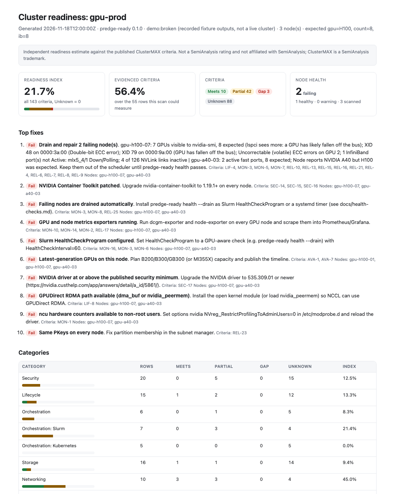

# Predge Cluster Readiness (`predge-ready`)

A command-line tool that a GPU cloud runs on its own GPU nodes. It does two jobs:

1. **Readiness report.** It scans the nodes and scores them against the 143 published ClusterMAX criteria, giving each row Meets, Partial, Gap or Unknown. You get category scores, an overall index and a ranked list of fixes, as JSON, a self-contained HTML page and Markdown. You can sign the JSON with Ed25519.
2. **Continuous health checks.** `predge-ready health` is a fast check that exits with a status code. You run it as the Slurm `HealthCheckProgram`, from cron or from a systemd timer. It catches XID errors, ECC errors, throttling, overheating, missing GPUs, NVLink and InfiniBand links that are down, and optionally slow NCCL. It can drain or cordon the failing node itself, and it writes Prometheus metrics.

> **Independent readiness estimate.** This is not a SemiAnalysis rating, and the project is not affiliated with or endorsed by SemiAnalysis. ClusterMAX is a SemiAnalysis trademark. A high score here does not predict a ClusterMAX medal.



## 1-minute quickstart

```bash
pipx install git+https://github.com/predgeAI/cluster-readiness

# See a sample report without a GPU (recorded outputs from a healthy and a broken cluster)
predge-ready scan --demo broken
open predge-ready-report/report.html        # xdg-open on Linux

# On a GPU node: scan it, state what was sold, sign the result
predge-ready scan --expect gpu=H100,count=8,ib=8 --sign

# Fast health check (exit 0 healthy, 1 warning, 2 failing, 3 could not check)
predge-ready health --expect gpu=H100,count=8
```

You need Python 3.9 or newer. The tool uses only the standard library. If the `cryptography` package is installed it is used for signing; otherwise a built-in RFC 8032 implementation is used. Sample reports are in [`docs/examples/`](docs/examples/).

## What `scan` checks

Every probe is read-only and needs no root. When a tool is missing or a file can't be read, the check reports **Unknown** with the reason instead of guessing.

| Area | What it looks at |
|---|---|
| GPU inventory | Model, count against `lspci` (to spot GPUs that have fallen off the bus), memory, driver and CUDA version, persistence mode, and the model and count you pass with `--expect` |
| GPU health | Clock-event (throttle) reasons, temperatures, volatile ECC errors, retired pages and row remapping, PCIe link width, NVLink link state, Fabric Manager, XID and SXID events from `dmesg` or `journalctl -k` |
| Fabric | `ibstat` port state, speed and link layer, ConnectX firmware, PKey table, HCA naming, `/etc/nccl.conf` (forced NCCL_PROTO/ALGO/MIN_NCHANNELS, GID index for RoCE), PCIe ACS (needs root) |
| GPUDirect | `dma_buf` path (open kernel module, kernel 5.12 or later) or `nvidia_peermem`, and GDRCopy |
| Software | NVIDIA Container Toolkit and driver against the published security minimums, Docker, Enroot/Pyxis, Apptainer, nvcc, HPC-X, NCCL, Lmod, DCGM |
| Scheduler | Slurm `HealthCheckProgram`, topology plugin, accounting, GPU GRES, PMIx. On Kubernetes: kubectl access, StorageClasses (RWX, default) and operators |
| Storage | Parallel filesystem (Lustre, Weka, GPFS, BeeGFS) versus NFS, and whether the shared mount responds |
| Monitoring | dcgm-exporter, node-exporter, ipmi_exporter, nv-hostengine, and automatic remediation (HealthCheckProgram, NHC, gpud, NPD, NVSentinel, the predge-ready timer) |
| Profiling | `RmProfilingAdminOnly` (ncu for non-root users), `perf_event_paranoid`, `kptr_restrict` |

`--active` also runs these tests where the tools exist. They load the GPUs, so use them on idle or drained nodes only:

- `dcgmi diag -r 3`
- the single-node nccl-tests `all_reduce_perf`
- `ib_write_bw` loopback between two HCAs
- an 8192³ bf16/fp16 GEMM through PyTorch

Each result is compared with a conservative floor for the GPU model.

### Many nodes

```bash
predge-ready scan --hosts hosts.txt --expect gpu=H100,count=8,ib=8   # over SSH (BatchMode, your SSH config)
predge-ready scan --slurm gpu                                        # every node sinfo lists in partition "gpu"
# or run on every node and merge:
srun -N 16 --ntasks-per-node=1 sh -c 'predge-ready scan --no-cmax --out /shared/pr --basename $(hostname -s) --format json'
predge-ready merge /shared/pr/*.json --out cluster-report
```

SSH mode installs nothing on the remote hosts. Each probe is a single read-only command. Across nodes the report also checks driver, GPU model and PKey consistency.

### Scoring

Each check is evidence for one or more criteria rows (run `predge-ready criteria` to list all 143). A row is:

- **Meets** when all of its evidence passes
- **Gap** when all of its evidence fails on every node
- **Partial** for anything mixed
- **Unknown** when nothing on a node can show it

Policy, commercial and provider-level rows (SOC 2, pricing, partnerships) are Unknown by design. You can record them with `--answers answers.json` (start from `predge-ready answers-template`). Those rows are marked *self-attested*, and they never override a measured result.

The **readiness index** counts Meets as 1 and Partial as 0.5 across all 143 rows. The report also shows the index over just the rows the scan could evidence.

### SemiAnalysis `cmax`

If the `cmax` CLI (`pipx install clustermax`) is installed, `scan` runs `cmax audit` and merges its 74 audit checks into the same criteria rows. Turn this off with `--no-cmax`, or import an existing run with `--cmax-results ~/.clustermax/audit/<run>`. No cmax code is bundled. The minimum-version floors in `src/predge_ready/data/minimums.json` are a snapshot of the clustermax 0.3.0 `minimum-versions.json` (Apache-2.0). You can override them with `--minimums`.

## Health checks and automatic drain

```bash
predge-ready health --drain --resume --textfile /var/lib/node_exporter/textfile_collector/predge_ready.prom
```

- **Exit codes:** `0` healthy, `1` warning, `2` failing, `3` could not check.
- **`--drain`:** runs `scontrol update nodename=<node> state=drain reason="predge-ready: XID 79, IB port down"` on Slurm, or `kubectl cordon <node>` plus an annotation on Kubernetes. A node that someone else already drained is left alone.
- **`--resume`:** undrains the node once it is healthy again, but only if `predge-ready` drained it.
- **`--nccl`:** adds a quick NCCL all_reduce of about 10 seconds.

A run without `--nccl` takes a few seconds. Run every minute, it flags a bad node in about two minutes.

See [docs/health-checks.md](docs/health-checks.md) for the Slurm `HealthCheckProgram` setup, a systemd unit and timer, cron, and a Kubernetes DaemonSet outline. Ready-made files are in [`contrib/`](contrib/).

## Signing

`--sign` creates a local Ed25519 key on first use (`~/.config/predge-ready/ed25519.key`, mode 0600) and embeds the public key and signature in the JSON. To check a report:

```bash
predge-ready verify report.json                      # integrity
predge-ready verify report.json --pubkey SHA256:...  # integrity + who signed it
predge-ready keygen                                  # print your fingerprint to publish
```

The signature covers the canonical JSON of the report without its `signature` field. It shows that a report hasn't been edited since the key holder produced it. It does not prove the hardware wasn't misrepresented to the tool.

## Privacy

Everything runs locally. The tool has no backend and sends nothing, and there is no telemetry and no network call. It only reads local state through standard tools, plus SSH to hosts you list. Reports are written to the directory you choose. Reports contain host names, GPU UUIDs and versions, so review them before you share them.

## Development

```bash
python -m unittest discover -s tests      # or: pytest
python scripts/make_fixtures.py           # regenerate the recorded node outputs
```

The fixtures in `src/predge_ready/fixtures/` are synthetic recordings in the exact output formats of nvidia-smi, ibstat, dmesg, dcgmi, nccl-tests, ib_write_bw and scontrol. There are four nodes: two healthy HGX H100 nodes, and two broken ones:

- an H100 node with XID 79, ECC errors, throttling and an InfiniBand rail down
- an A40 node where H100 was expected

## License and disclaimer

Apache-2.0; see [LICENSE](LICENSE) and [NOTICE](NOTICE).

This project is not affiliated with, endorsed by or sponsored by SemiAnalysis. "ClusterMAX" is a trademark of SemiAnalysis and is used here only to refer to its publicly published criteria. The criteria IDs (SEC-1, REL-25, and so on) are Predge's own numbering. Scores are an independent estimate and are not a ClusterMAX rating.
